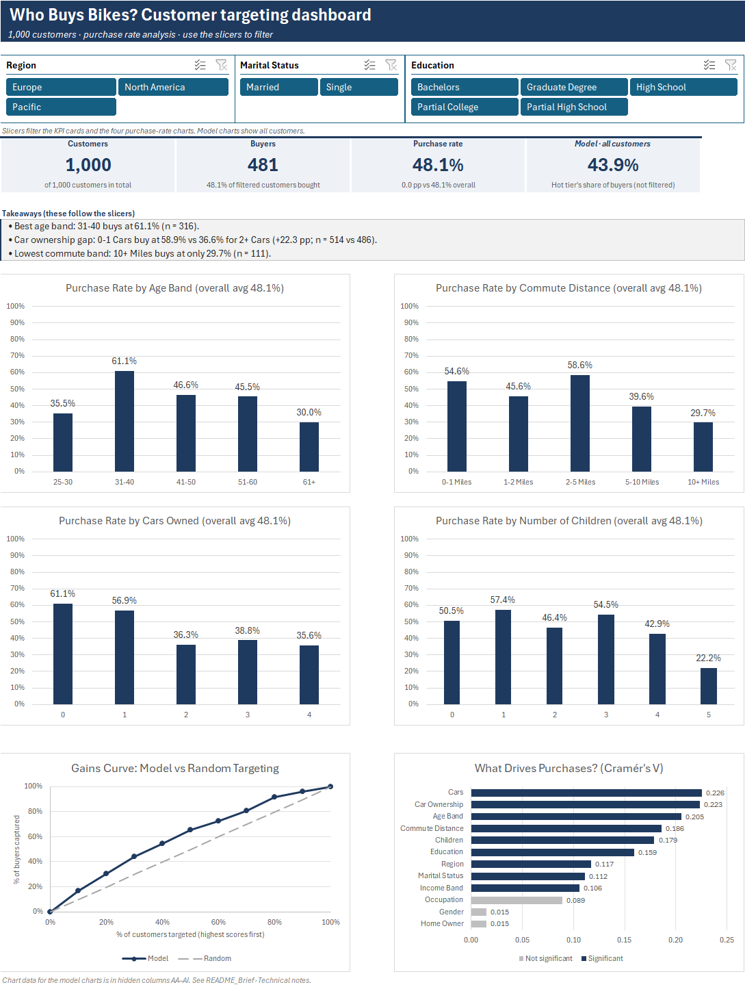
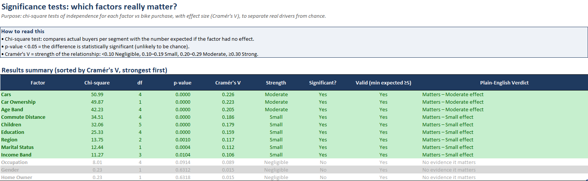
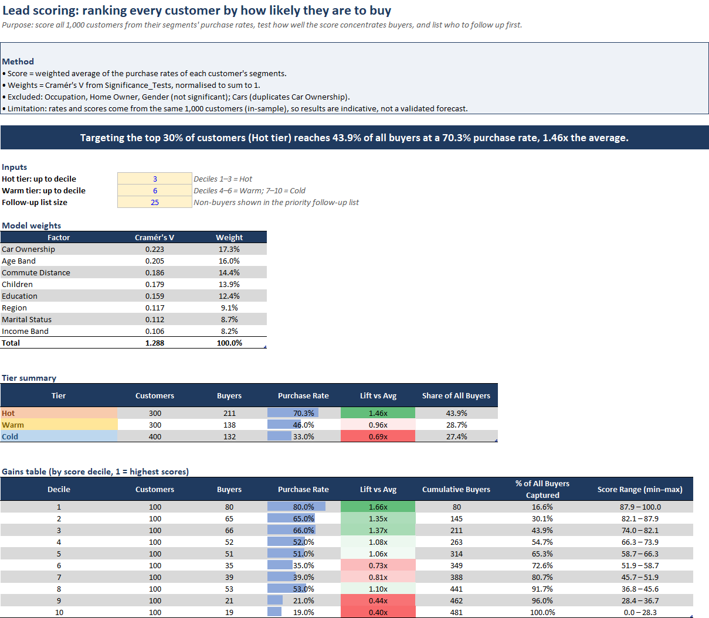
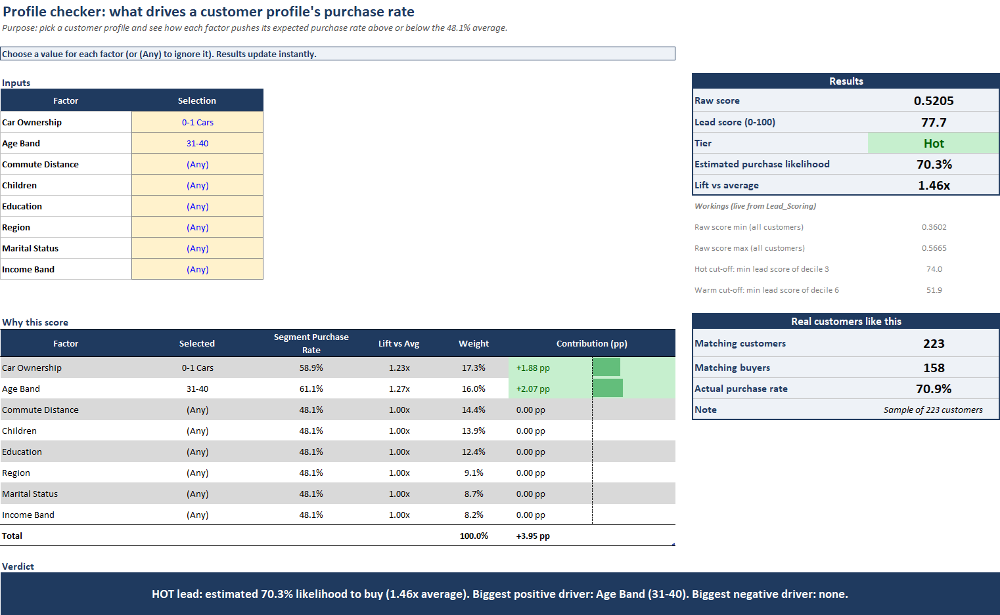
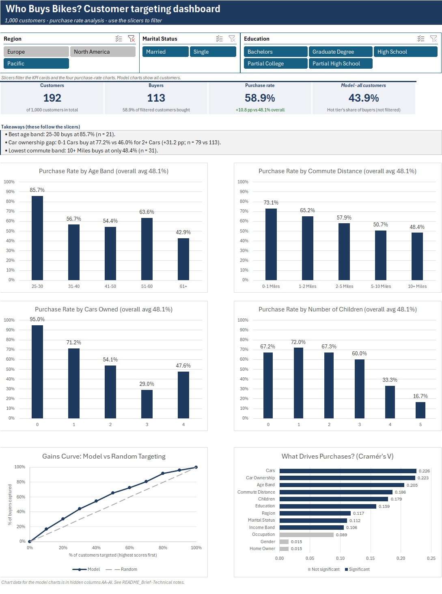

# Who buys bikes? A customer targeting analysis

A bike retailer has 1,000 customer records and a limited marketing budget. This Excel workbook works out who is most likely to buy, and who to call first.



## The question

Which customers should the retailer target to sell more bikes?

The measure throughout is purchase rate: buyers divided by customers in a group. Raw counts can mislead here. The 0–1 mile commute group has the most buyers simply because it's the biggest group, but 2–5 mile commuters buy at a higher rate.

## What the data says

Car ownership matters more than anything else in the model. Customers with 0–1 cars bought at 58.9%. With two or more cars, that falls to 36.6%.

Age comes next. People aged 31–40 bought at 61.1% (316 customers), roughly double the 30.0% rate for customers over 60.

Commute distance follows a similar pattern: 58.6% for 2–5 miles, 29.7% for 10+ miles. Pacific customers bought at 58.9%, against 43.3% in North America.

Gender, home ownership and occupation made no measurable difference (chi-square p = 0.63, 0.63 and 0.09). That's worth knowing, because it means a campaign doesn't need to split on them.

The lead-scoring model puts this together. The top 30% of customers by score bought at 70.3%, which is 1.46 times the 48.1% average, and that group alone contains 43.9% of all buyers.

| Tier | Customers | Purchase rate | Share of all buyers |
|---|---|---|---|
| Hot | 300 | 70.3% | 43.9% |
| Warm | 300 | 46.0% | 28.7% |
| Cold | 400 | 33.0% | 27.4% |

One sanity check: for customers with 0–1 cars aged 31–40, the model predicts 70.3%. The 223 real customers with that profile bought at 70.9%.

## How this differs from the tutorial

The data comes from Alex The Analyst's Excel tutorial, which builds a dashboard from buyer counts. This version uses the same data and takes it further:

| Tutorial | This project |
|---|---|
| Counts of buyers | Purchase rates and lift, so big groups don't look good just for being big |
| Charts | Chi-square tests to check which differences are real |
| Describes the past | Scores every customer and ranks them into Hot, Warm and Cold tiers |
| Fixed view | A profile checker that scores any combination of traits |
| Duplicates removed quietly | A data quality log with live pass/fail checks |
| Dashboard | Dashboard plus written recommendations and their limits |

## Inside the workbook

| Sheet | What's on it |
|---|---|
| Dashboard | KPI cards, four purchase-rate charts driven by slicers, a gains curve and a factor-importance chart |
| README_Brief | The brief, a sheet index, and technical notes on 14 design decisions |
| Data_Dictionary | Each field, its type, its unique values and what cleaning it needed |
| Data_Quality_Log | The cleaning steps and seven live validation checks |
| Clean_Data | 1,000 customers after removing 26 duplicate rows, plus eight derived columns |
| Segment_Analysis | Purchase rate and lift for every group across 12 factors |
| Significance_Tests | Chi-square test and Cramér's V for each factor |
| Lead_Scoring | The scoring model, deciles, gains table, tiers and a follow-up list |
| Profile_Checker | Pick a profile from dropdowns and see its score and what drives it |
| Pivot_Analysis | The nine PivotTables behind the dashboard |
| Recommendations | Seven actions, each tied to a number, plus limitations |
| Raw_Data | The original data, untouched |

## Method

### Cleaning

The raw file had 1,026 rows. 26 were exact duplicates, which leaves 1,000 customers. Marital status and gender codes were decoded, and age, income and car ownership were grouped into bands. The Data Quality Log rechecks the cleaned table against the raw one with live formulas, so if something breaks, a check turns red.

### Segments and significance

Every factor was broken into groups and compared on purchase rate. Then each one went through a chi-square test, with Cramér's V to show how strong the effect is. Nine factors were significant. The three that weren't were left out of the model.



### Lead scoring

Each customer's score is a weighted average of the purchase rates of the groups they belong to. The weights come from Cramér's V, so stronger factors count for more. Customers were then ranked into ten deciles and grouped into tiers. The gains curve shows how much faster the score finds buyers than picking customers at random.



### Profile checker

Choose a value for each factor (or leave it as "Any") and the sheet returns a score, a tier, an estimated likelihood, and a breakdown of which factors push the score up or down. It also counts how many real customers match that profile and how many of them bought.



### Dashboard

Three slicers (region, marital status, education) filter every chart and KPI card at once. Two safeguards are built in. A warning appears when a filter leaves fewer than 50 customers, and the written takeaways skip any group with fewer than 10. Without those, filtering down far enough would produce claims like "100% bought" based on two people.



## Behind the scenes

The README_Brief sheet documents every non-obvious decision. A few that might otherwise look odd:

- Columns AA to AI on the dashboard are hidden on purpose. They hold a reshaped copy of the model results, which the two model charts need in order to draw. The `#N/A` values in them are intentional: Excel skips them, which is how the significant and non-significant bars get different colours.
- Clean_Data holds pasted values, not formulas, because an Excel Table can't contain a live `UNIQUE()` result. The Data Quality Log makes up for this by checking it against the raw data.
- The commute order in the PivotTables was set by hand. Otherwise Excel sorts it alphabetically and puts "10+ Miles" before "2-5 Miles".
- Ties in the lead score are broken by customer ID, so each decile holds exactly 100 customers.

## Limitations

The model was built and evaluated on the same 1,000 customers, so it will probably do worse on new ones. Car ownership may also be standing in for something else, such as income or where people live. The data shows a pattern, not a cause.

The scores rank customers well at the top and bottom but less cleanly in the middle. Decile 8 bought at 53%, more than deciles 4 to 7, which is why the recommendations use tiers rather than exact scores.

There's no cost or revenue data, so return on a campaign can't be estimated. And this is a public practice dataset, not a real company's customers.

If this were real, the next steps would be an A/B test of Hot-tier targeting against random targeting, a logistic regression refit once new data comes in, and adding cost per contact and margin per bike.

## Skills used

Excel: Tables, dynamic arrays (`LET`, `XLOOKUP`, `UNIQUE`, `FILTER`, `SORTBY`, `TAKE`), `COUNTIFS`, `CHISQ.TEST`, PivotTables and PivotCharts, slicers, `GETPIVOTDATA`, data validation, conditional formatting, named ranges.

Analysis: cleaning and validation, segmentation, hypothesis testing, effect size, lead scoring, gains analysis, writing recommendations for a non-technical reader.

## Opening the file

1. Download `workbook/Bike_Buyers_Targeting_Analysis.xlsx`.
2. Open it in Microsoft 365 or Excel 2024. Older versions don't support some of the formulas, such as `TAKE`.
3. Click Enable Editing if Excel asks.
4. It opens on the dashboard. Click slicer buttons to filter, and the funnel-with-an-X icon to clear them.
5. Try the Profile_Checker sheet to score a profile of your own.

## Repository layout

```
bike-buyers-targeting-analysis/
├── data/
│   └── bike_buyers_raw.xlsx        # original data
├── workbook/
│   └── Bike_Buyers_Targeting_Analysis.xlsx
├── images/                         # screenshots used here
└── README.md
```

## Credits

Dataset: [Alex The Analyst](https://github.com/AlexTheAnalyst), from his Excel tutorial series.
Analysis, model and dashboard: Malachy Ugwu ([GitHub](https://github.com/Shikamaru-n))
